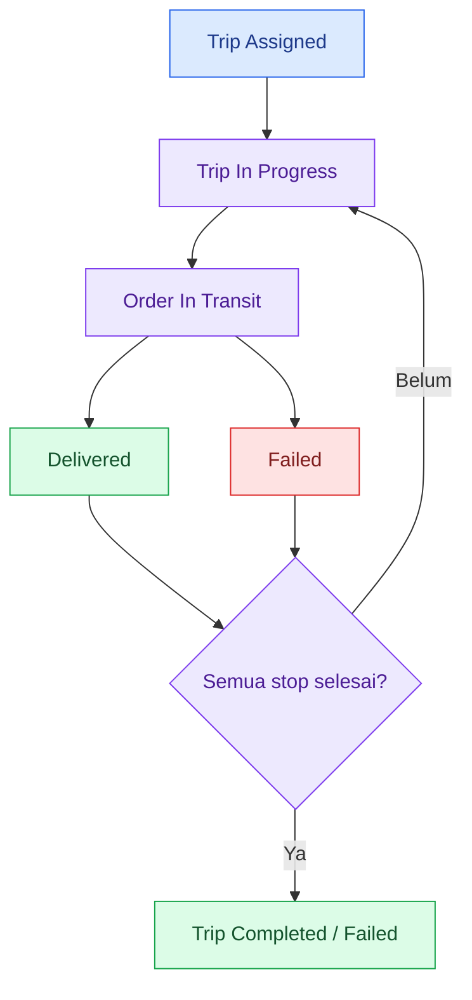

# 🚚 TMS Mobile — Transportation Management System

<div align="center">

  

  ### Digitalizing the Last-Mile Delivery Experience

  **A modern driver application built with React Native, Expo & TypeScript.**

  <p>
    
    
    
    
  </p>

  <p>
    <a href="#-fitur-unggulan">Fitur</a> •
    <a href="#-preview-aplikasi">Preview</a> •
    <a href="#-teknologi">Teknologi</a> •
    <a href="#-instalasi">Instalasi</a>
  </p>

</div>

---

## 🌟 Tentang Proyek

TMS Mobile adalah aplikasi mobile untuk driver yang berfokus pada operasional pengiriman barang. Aplikasi ini membantu driver mengelola trip, memproses delivery order (DO), mencatat hasil pengiriman, dan memantau riwayat perjalanan melalui satu antarmuka.

Proyek ini merupakan **portofolio independen** yang terinspirasi dari proses bisnis Transportation Management System. Aplikasi menggunakan data sintetis dan bukan merupakan aplikasi resmi perusahaan mana pun.

> 🎯 Fokus utama: menyederhanakan alur kerja driver, menerapkan validasi bisnis yang konsisten, dan menjaga status pengiriman tetap terstruktur.

## 📱 Preview Aplikasi

> Ganti gambar di bawah dengan screenshot asli dari aplikasi yang dijalankan di Expo Go atau emulator Android.

<div align="center">

  <table>
    <tr>
      <td align="center" width="33%">
        <b>🔐 Login</b><br/><br/>
        
      </td>
      <td align="center" width="33%">
        <b>📊 Beranda</b><br/><br/>
        
      </td>
      <td align="center" width="33%">
        <b>🚛 Detail Trip</b><br/><br/>
        
      </td>
    </tr>
    <tr>
      <td align="center">
        <b>📦 Delivery Order</b><br/><br/>
        
      </td>
      <td align="center">
        <b>✅ Proses Pengiriman</b><br/><br/>
        
      </td>
      <td align="center">
        <b>📜 Riwayat</b><br/><br/>
        
      </td>
    </tr>
  </table>

</div>

## ✨ Fitur Unggulan

<table>
  <tr>
    <td width="50%">
      <h3>📊 Dashboard</h3>
      Ringkasan trip, status pengiriman, prioritas order, timeline stop, dan aktivitas terbaru.
    </td>
    <td width="50%">
      <h3>🚚 Trip Management</h3>
      Daftar trip berdasarkan tanggal dan status, detail kendaraan, jadwal, stop, serta log aktivitas.
    </td>
  </tr>
  <tr>
    <td width="50%">
      <h3>📦 Delivery Orders</h3>
      Pencarian berdasarkan nomor DO, penerima, kota, atau alamat, disertai filter status.
    </td>
    <td width="50%">
      <h3>✅ Delivery Processing</h3>
      Mulai pengiriman, konfirmasi penerima, catatan, bukti simulasi, dan laporan kegagalan.
    </td>
  </tr>
  <tr>
    <td width="50%">
      <h3>📜 Delivery History</h3>
      Riwayat trip dan pengiriman yang dapat difilter berdasarkan tanggal dan hasil.
    </td>
    <td width="50%">
      <h3>⚙️ Profile & Settings</h3>
      Informasi driver, kendaraan, pengaturan prioritas, reset data demo, dan logout.
    </td>
  </tr>
</table>

### 🛡️ Business Rules

Aturan bisnis dipisahkan dari UI agar proses pengiriman lebih konsisten dan mudah diuji.

| Proses | Validasi |
|---|---|
| Mulai trip | Trip harus berstatus `Assigned`, sesuai jadwal, dan tidak ada trip lain yang sedang berjalan. |
| Mulai order | Trip harus `In Progress`; satu order aktif per trip. |
| Konfirmasi DO | Order harus `In Transit`; nama penerima 3–60 karakter. |
| Bukti pengiriman | Order berprioritas tinggi wajib memiliki bukti simulasi. |
| Pengiriman gagal | Alasan harus valid; alasan lainnya membutuhkan penjelasan minimal 5 karakter. |
| Penyelesaian trip | Status akhir ditentukan otomatis berdasarkan hasil semua stop. |

**Status flow**



## 🧰 Teknologi

<div align="center">

| Teknologi | Penggunaan |
|---|---|
| ⚛️ React Native | Antarmuka mobile |
| 🟣 Expo SDK 58 | Development dan bundling |
| 🔷 TypeScript | Type safety dengan strict mode |
| 🧭 Expo Router | Navigasi berbasis file |
| 💾 AsyncStorage | Penyimpanan lokal |
| 🎨 Lucide React Native | Ikon antarmuka |
| 🧪 Node.js Test Runner | Unit testing |
| 🧹 ESLint | Pemeriksaan kualitas kode |

</div>

## 🏗️ Arsitektur

```text
┌───────────────────────────────┐
│        Mobile Interface       │
│  Login · Trip · Orders · DO   │
└───────────────┬───────────────┘
                │ User Actions
                ▼
┌───────────────────────────────┐
│         App Provider           │
│       State Management         │
└───────────────┬───────────────┘
                │
                ▼
┌───────────────────────────────┐
│       Business Rules           │
│        tripRules.ts            │
└───────────────┬───────────────┘
                │
                ▼
┌───────────────────────────────┐
│        AsyncStorage            │
│       Local Persistence        │
└───────────────────────────────┘
```

Semua aksi utama diproses melalui provider dan fungsi aturan bisnis. Perubahan yang valid memperbarui state dan disimpan ke perangkat, sedangkan aksi yang tidak valid menghasilkan pesan error tanpa mengubah data.

## 📁 Struktur Proyek

```text
tms-mobile-app/
├── assets/
│   └── images/
├── docs/
│   └── screenshots/
├── src/
│   ├── app/
│   │   ├── _layout.tsx
│   │   ├── login.tsx
│   │   ├── (tabs)/
│   │   ├── trip/[id].tsx
│   │   ├── order/[id].tsx
│   │   └── deliver/[id].tsx
│   ├── components/
│   ├── constants/
│   ├── data/
│   ├── services/
│   ├── state/
│   ├── types/
│   └── utils/
├── tests/
├── app.json
├── package.json
└── README.md
```

## 🚀 Instalasi

### Persyaratan

- Node.js 22.18 atau lebih baru.
- npm.
- Android dengan Expo Go yang kompatibel atau emulator Android.

### 1. Clone repository

```bash
git clone https://github.com/sirajfatwasidqy/TMS-MOBILE.git
cd TMS-MOBILE
```

### 2. Instal dependensi

```bash
npm install
```

### 3. Jalankan aplikasi

```bash
npx expo start
```

Pindai QR code menggunakan Expo Go. Pastikan laptop dan HP berada di jaringan yang sama.

Jika koneksi lokal bermasalah, coba:

```bash
npx expo start --tunnel
```

### 🧪 Pemeriksaan Kode

```bash
npm run typecheck
npm run lint
npm test
npm run check
```

## 🔑 Akun Demo

| Kolom | Nilai |
|---|---|
| ID Driver | `RAJA123` |
| Kata Sandi | `123RAJA` |
| Nama Driver | Raja Pratama |

Gunakan akun tersebut hanya untuk pengujian aplikasi demo.

## 📦 Data Sintetis

Aplikasi menyediakan contoh data untuk menguji berbagai skenario operasional:

- 8 trip dan 19 delivery order.
- Satu driver dan dua kendaraan.
- Trip aktif, trip terjadwal, pengiriman selesai, serta pengiriman gagal.
- ID trip dan DO unik dengan relasi data yang konsisten.

Data disimpan secara lokal di perangkat. Gunakan menu **Profil → Reset data demo** untuk membuat ulang dataset.

## 🧪 Status Pengujian

| Pemeriksaan | Status |
|---|---|
| TypeScript typecheck | ✅ Lolos |
| Expo lint | ✅ Lolos |
| Unit test | ✅ 17 test lolos |
| Android export | ✅ Berhasil |
| Pengujian visual perangkat | ⏳ Belum diverifikasi |
| iOS dan web | ⏳ Belum diuji |

Status ini mencerminkan hasil pemeriksaan pengembangan yang tercatat saat proyek dibuat, bukan hasil pengujian terbaru pada setiap perangkat.

## ⚠️ Batasan

- Login masih berupa simulasi lokal, bukan autentikasi produksi.
- Tidak ada backend atau sinkronisasi antarpengguna.
- Tidak ada pelacakan GPS real-time atau peta aktif.
- Bukti pengiriman masih berupa simulasi, bukan foto atau tanda tangan yang tersimpan.
- Data demo hanya disimpan di perangkat.

## 🛣️ Roadmap

- [ ] Integrasi backend dan autentikasi berbasis peran.
- [ ] Foto dan tanda tangan digital sebagai bukti pengiriman.
- [ ] Sinkronisasi data saat koneksi kembali tersedia.
- [ ] Peta rute dan navigasi.
- [ ] Notifikasi push untuk penugasan trip.
- [ ] Pengujian UI dan end-to-end.
- [ ] Dukungan bahasa Inggris dan tema gelap.

## 🔒 Disclaimer

TMS Mobile merupakan proyek portofolio independen yang menggunakan data sintetis. Proyek ini tidak terhubung dengan sistem internal perusahaan mana pun dan tidak mewakili produk resmi perusahaan.

Logo Duta Abadi Primantara hanya boleh dipublikasikan sesuai izin pemilik hak terkait. Logo dan aset merek tidak termasuk dalam lisensi kode proyek.

## 📄 Lisensi

Kode sumber dilisensikan di bawah [MIT License](LICENSE). Lisensi tersebut tidak mencakup logo, merek dagang, maupun aset pihak ketiga.

---

<div align="center">

  **Built with TypeScript, React Native & Expo**

  *Exploring mobile development, business process automation, and transportation management systems.*

  <sub>Independent portfolio project · Indonesia 🇮🇩</sub>

</div>
